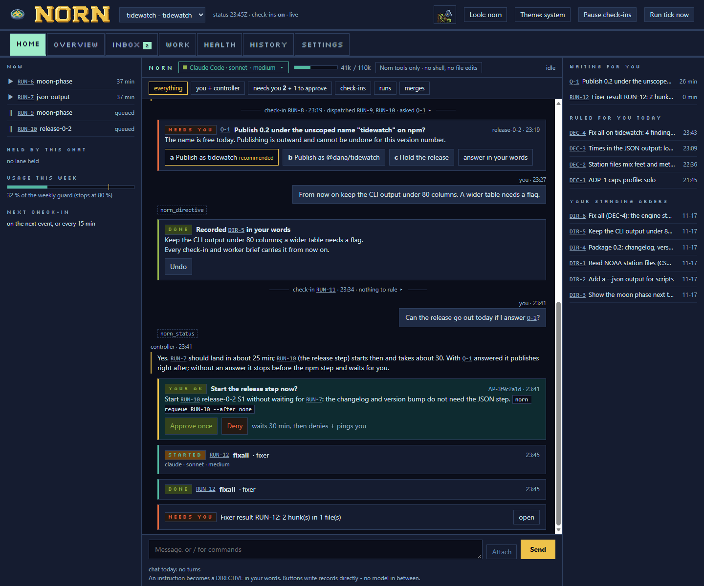
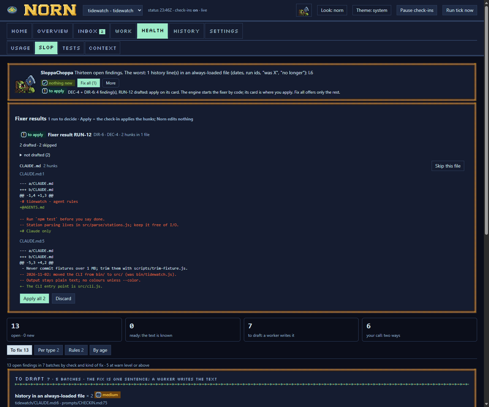

# Norn

Norn runs coding agents (Claude Code, Codex or any command-line agent) on your own machine and keeps long work going without you.
It is designed to spend fewer tokens and to guard a project against drift, bloat and slop:

- **Tokens**: each agent hands off to a fresh session at a set context size, so a long task never re-reads one huge conversation
  on every turn.
- **Bloat**: Norn checks the instruction files agents re-read on every turn (CLAUDE.md, AGENTS.md, memory) for excess size and
  repeated or outdated text, without calling a model.
- **Drift**: it flags instructions that name files, lanes or models that no longer exist, and generated agent files edited by hand.
- **Slop**: before a branch can merge, Norn checks it for leftovers such as conflict markers, stray logs, unused imports and a
  committed `.only`, and sends the findings back to the agent.

You answer only the questions it cannot decide.



## Why use it

### Automatic hand-off

Each agent role has three context limits: start no new step, hand off, and hard stop (90k, 110k and 150k tokens by default for
most roles; set per role in Settings). Norn measures a run's context after every tool call and tells the agent when it
crosses a limit. At the hand-off limit the agent writes its hand-off and ends with `norn done --outcome handoff`; at the hard stop Norn ends the
run itself and writes the hand-off. Either way Norn resumes the work in a fresh session that starts from the hand-off and the
records, not from the old conversation. Queued steps start as soon as the steps they wait for land, so the work continues while you are away.

### Fewer tokens spent

An agent re-reads its whole context on every turn, including every instruction file it loads. Norn keeps both small:

- **Context**: the hand-off above keeps each session short. The Context page shows each role's context size, how many tokens each
  loaded file costs per session, and whether that is growing.
- **Markdown**: Norn checks the files your agents load on every turn (CLAUDE.md, AGENTS.md, MEMORY.md, rules) for text that costs
  tokens without helping: history lines in an always-loaded file, a MEMORY.md over 200 lines or 25 KB, a Codex
  AGENTS.md chain over 32 KiB, one rule kept in several files, and twin AGENTS.md and CLAUDE.md files. These checks read files
  only; they never call a model.

### Protection against drift

- **Instructions that no longer match the repo**: Norn flags paths that do not exist, pointers to moved or renamed files, lanes
  that are closed, retired model names, and memory lines that restate a rule the repo already has.
- **Generated files**: numbers that live in Settings are written into prompt files by Norn, never copied by hand. `norn gen --check`
  reports any generated agent file that was edited by hand, and Norn never overwrites that edit.
- **Your instructions**: a directive you give stays in force for every check-in and every agent brief until you revoke it.
- **An agent's word**: when an agent says it is done, Norn checks for itself that the tree is clean, the changes are inside the
  brief's scope and the tests pass.

### SloppaChoppa

Before a lane's branch can merge, Norn checks its changes against main for leftovers: conflict markers, generated files out of
date, stray logs, binaries over 1 MB, a committed `.only` in a test that silently stops the rest of the suite, and a skip with no condition (the last two also in
TypeScript, Python and Rust tests, in shadow). It also finds
empty or reason-less catch blocks in JavaScript, TypeScript, Python and Rust (TypeScript, Python and Rust in shadow until proven),
unused variables and imports in JavaScript (ESLint) and Python (ruff), and import cycles and broken layer rules in JavaScript,
TypeScript and Python (layers in Rust). Comments and strings that keep an old name alive or defer work with no record, and
commented-out code, are read in all four languages (TypeScript, Python and Rust in shadow; Python's commented-out code is ruff's ERA001). The
findings go back to the same agent as one resume, and the merge waits until each is fixed or waived. The Slop page lists every open finding, from branches and from
instruction files, grouped by the kind of fix; a finding from a branch opens its own row. "Fix all" sends the selected findings to
a read-only fixer run. Its result card, in the Inbox and on Slop, shows every file and every hunk as a diff, with "Apply all n"
and "Skip this file"; the check-in applies what you approve. SloppaChoppa, an orc, presents the findings; you can switch him off per project.



### Also

- **Usage stays inside your plan.** Before any run starts, Norn checks the worker cap, an hourly rate cap and a weekly stop. The
  usage forecast (`norn plan`, and on the dashboard's usage page) shows when the queued work would reach the limit.
- **Main stays green.** Each lane has its own git worktree and one writer. Finished work merges to main one branch at a time,
  through your test command.
- **Decisions are on record.** Every question, decision and instruction is an append-only record. You can see why something
  happened and overrule it.
- **Local and vendor-neutral.** Norn needs only Node 22 and git. It installs no npm packages, stores no API keys, and its dashboard
  listens on 127.0.0.1 only. Each run can use Claude Code, Codex or any other headless CLI.
- **Runs from your phone too.** Notifications reach your phone, and over your own Tailscale network the full dashboard does
  as well: answer questions and approve work from anywhere. See [On your phone](#on-your-phone).

For one task you watch from start to finish, Claude Code on its own is simpler. Norn's check-ins are agent turns too and count
toward your usage.

## What you get

The dashboard (`norn dash`). Its bar is Home, Overview, Inbox, Work, Health, History and Settings; Work, Health and History each
open a row of pages.

- **Home**: a controller chat. It answers from the records and acts only through Norn's own commands; anything that needs your
  OK waits on an approval card. Check-ins, runs and questions appear in the same thread.
- **Lanes**: every lane by what it needs from you. Its Waiting group lists the queued lanes in start order, each with its priority
  control, time estimate, start and what it waits for (`norn plan` prints the same plan, with the chains and what merges next).
- **Runs**: one table of every run (state, lane and stage, model, age, tools / words / commits, pace); a row opens the run's
  document and live feed in a drawer.

- **Inbox**: the questions waiting for you, each with its options and a recommended answer.
- **Slop** (Health): every open finding, grouped by the kind of fix, with "Fix all" and the fixer's result cards (see SloppaChoppa above).
- **Docs** (History): a reader for the project's docs and every file that instructs an agent, with the findings next to the line.
- **Context** (Health): the context limits per role, the tokens per loaded file, and whether they are growing.
- **Roadmap** (Work, `norn road`): themes and items whose status comes from the runs and records, never typed by hand.
- **The other pages**: Overview (what needs you and what is running), Lanes and Map (every lane and its latest run), Runs
  (running and recent runs with their tokens and context), Spend (usage against the limits, and which model suits which work),
  Tests (which tests check real behaviour), Records and Ledger (every decision and check-in), and Settings.

Around the dashboard:

- **Adopting a repo** (`norn init`): drafts a roadmap, project rules, the test command and a first task from your repository;
  you approve each part.
- **Monorepos** (`norn init <repo>/<folder>`): each folder can be its own project, with its own rules, roadmap, merge gate and
  lanes, and work stays inside the folder. See [SETUP.md](SETUP.md#a-monorepo-one-project-per-folder).
- **Minimum worker model** (Settings > Executors & models > Minimum for workers, or `worker_min_model` /
  `worker_min_effort` in `local/budget.json`): no worker run goes below it. Merge runs, helpers and reviews count as workers;
  check-ins and the chat keep their own model. A run asked for less is raised to the minimum, and the run record says so.
  A worker setting below the minimum is refused. Raising the minimum raises the settings below it in the same save. A
  profile is raised to it too. Only Claude models are compared; Codex runs keep their own models.
- **Done checks** (per project): see [Done checks](#done-checks) below.
- **Notifications** and **phone access**: see [On your phone](#on-your-phone) below.
- **MCP server** (`norn mcp`): agents in Claude Code or Codex can use Norn's commands; `norn harness install` adds it.
- **Screenshots** (`norn shot`): a signed-out headless browser for checking UI work.

## On your phone

The dashboard works at phone width. From your phone you can read the Home thread, chat with the controller, answer Inbox
questions, approve or deny approval cards, and pause check-ins. Two pieces make that work:

- **Notifications.** Setup offers the free ntfy phone app, a desktop notification or Pushover. Norn sends a notice when something
  needs you; other news arrives as one summary every few hours. With phone access on, each notice carries an "Open Norn" link.
- **Tailscale.** Tailscale is a free app that joins your own devices into a private network that only devices signed in to your
  account can reach. Norn uses its Serve feature to carry the dashboard to your phone over that network. The dashboard itself
  still listens only on 127.0.0.1, and nothing is exposed to the public internet.

To set it up (about 10 minutes, Tailscale's free Personal plan is enough):

1. Install Tailscale on the PC and the phone, and sign in to both with the same account.
2. Run `node engine/bin/norn.mjs remote setup`. It checks for Tailscale and prints each command with what it does; nothing changes
   until you run it again with `--apply`. The first time, Tailscale may print a link to turn Serve on for your account.
3. Run `node engine/bin/norn.mjs dash restart`.
4. On the PC, open Settings > Notifications > Reach Norn from your phone > Pair a device. Open `https://<pc>.<tailnet>.ts.net/` on
   the phone and enter the single-use code.

Norn answers only your PC's Tailscale name and only your Tailscale login. A device that is not paired sees only the pairing page,
and every action taken from the phone, approvals included, is recorded with that device. Norn refuses requests that arrive
through Tailscale Funnel, which is the public internet. `norn remote off --apply` turns phone access off. For a phone without
the Tailscale app, [SETUP.md](SETUP.md#reach-norn-from-your-phone) describes a Cloudflare Tunnel alternative.

## Quick start

You need Node 22 or newer, git, and the `claude` CLI signed in to your Claude account. `codex` and `gh` are optional. Norn runs on
Windows, Linux and macOS.

```
node engine/bin/norn.mjs init <your repo>   # set up Norn and add your repo; you approve each part
node engine/bin/norn.mjs run --executor fake --lane <first lane> --brief <its brief> --project <name> --wait   # a free rehearsal; init prints this line
node engine/bin/norn.mjs dash --background  # start the dashboard (no window), open http://127.0.0.1:8737, start the first lane
```

`init` checks your tools and adds your repository as a project. It asks which limits profile to start with (`try-it` by default,
or `solo` / `heavy`), and whether an agent may read the repo for a better draft (one paid, read-only run) or git alone drafts it
(free). It writes nothing into your repo and applies nothing until you approve it. Setup also offers notifications and puts a
`norn` command in `~/.local/bin`. The full walkthrough is in [SETUP.md](SETUP.md).

Fresh installs were tested by following SETUP.md on clean Windows and Linux machines. macOS is covered only by the automated smoke
test, which runs on all three systems.

## How it works

- **Lanes and runs.** A lane is one line of work with its own worktree and branch. `norn run --executor <name> --lane L --brief F`
  starts an agent in it. Norn takes the lane's lock, checks the limits and records the run. The agent ends with `norn done`, which writes the
  run's own result: done, stopped (with why) or handoff (with its hand-off text); a run that writes none ends no-result. A
  hand-off resumes the work in a fresh session that reads the hand-off. `--queue` and `--after` queue a run behind others, and `norn stop RUN-n` stops one. `norn executors --caps`
  lists the executors.
- **Check-ins.** A scheduled `norn tick` runs one short agent turn after each event and on a timer. It reviews finished runs,
  queues merges, starts the next steps and asks you what only you can decide.
- **Landing comes first.** Finished work lands before new work starts. After each tick, `norn mergeq --run` takes a clean, pushed
  deliverable, merges it with main in its own merge worktree, runs a quick check (the syntax of the changed files and their own
  test files, one at a time; never the full suite, which runs in CI) and opens the lane branch's pull request. No agent runs for
  this. Only a conflict, a red check or a slop block queues a MERGE run, and that run's brief describes the failure. A MERGE or
  resolve run is queued at the priority of the work it lands, never below P1. It goes ahead of build and plan runs of its own priority and the next one up, and `policy.fill.merge_reserve` slots (default 1)
  stay free for it while it waits. `norn requeue RUN-n --priority P0-P4` (or the priority control on a queued run in Runs or Lanes) changes a
  queued run's priority and keeps its `--after` conditions. Lanes and Overview show `done, not merged: N (oldest Xh)`. When the
  backlog is above `policy.merge.backlog_max` (default 3), the check-in is told to land work before it starts new lanes.
- **Records.** Questions, decisions, directives, lanes and runs are append-only events, written only through `norn rec`,
  `norn run` and the dashboard. The markdown views are generated from them.
- **Executors.** A project's `project.json` defines them: `claude-compatible` (Claude Code against a compatible endpoint),
  `openai-compatible` (the Codex CLI with a custom provider) or `cli` (any headless CLI, its arguments as a template). Norn never
  stores an API key; the project names the environment variable that holds it. `projects/example/project.json` has one of each.
- **Settings.** Machine-wide limits live in `local/budget.json`, per-project policy in `project.json`; Settings (the cog at the top right of the dashboard) edits both.

### Done checks

Each part is set per project in Settings and is off by default.

- **Ready**: `norn run` refuses (or warns about) a brief without the lines `Scope:` (the paths the run may change), `Tests:` (test
  files or a command) and `Done:` (what done means).
- **Done**: when a run says DONE, Norn checks that the tree is clean and the changes are inside Scope, then runs the Tests and the
  merge gate. A failure sends the run back once with the evidence; a second failure stops it.
- **Scope guard**: while a Claude run works, it cannot edit files outside its worktree and Scope, force-push, push to main (merge
  runs excepted), or run destructive git, gh or rm commands outside its worktree. The agent sees the reason and can carry on; each
  refusal is listed in the run's feed.
- **Plan review**: a finished plan gets one fresh, read-only review before its build starts.

## Commands

`norn help` lists every command; `norn <command> --help` shows one. The ones you meet first: `init`, `setup`, `doctor`, `smoke`,
`dash`, `status`, `runs`, `run`, `stop`, `tick`, `sched`, `rec`, `plan`, `road`, `lane`, `shot`.

## Layout

- `engine/`: the CLI (`bin/norn.mjs`), libraries (`lib/`), the dashboard (`dash/`, see [engine/dash/README.md](engine/dash/README.md)),
  prompts and schemas.
- `projects/example/`: the sample project the smoke test uses. Your projects live outside this clone (`~/.norn/projects/`).
- `local/` (machine.json, budget.json) and `state/` (records, runs, logs) are per machine and not tracked.

## Tests

`node --test "tests/*.test.mjs"` runs the suite in temp folders, with a fake executor in place of every agent. `norn smoke` runs a
fresh copy end to end. CI runs the smoke test on Windows, Ubuntu and macOS (`.github/workflows/smoke.yml`).

## Glossary

- **Lane**: one line of work with its own git worktree and branch. One agent at a time writes in it.
- **Run**: one agent session in a lane, until its `DONE`, `STOPPED` or `HANDOFF` line.
- **Check-in**: one short agent turn that reviews the state, rules on finished runs and starts the next ones (`norn tick`, by hand
  or from the scheduler).
- **Directive**: a standing instruction from you that every check-in follows until you revoke it.
- **Profile**: a starting set of limits and routing (`try-it`, `solo`, `heavy`); change any value later in Settings.

## Beta feedback

This is a beta. Open this repository's **Issues** tab, choose **New issue**, then **Beta feedback**. The form asks what you tried,
what went wrong or was confusing, your OS, and whether to keep SloppaChoppa (to switch him off: Settings, Slop voice, On / off).

## License

MIT, see [LICENSE](LICENSE).
