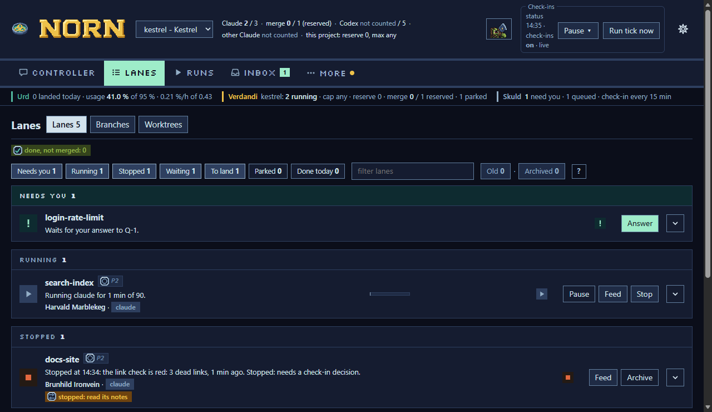
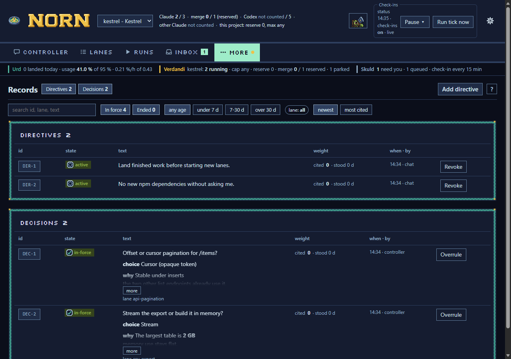

# Norn

Norn runs coding agents (Claude Code, Codex or any headless command-line agent) on your own machine and keeps many of them working
at once without you watching. Each piece of work gets its own git worktree, a queue starts runs inside your usage limits, a
scheduled check-in reviews what finished and starts what is next, and you answer only the questions Norn cannot decide.


## What you get

- **Lanes.** A lane is one line of work with its own git worktree and branch (`norn/<lane>`). One agent at a time writes in it,
  so parallel agents never share a tree and your main checkout is not touched.
- **A queue inside your limits.** Before a run starts, Norn checks the worker cap, an hourly usage-rate cap and a weekly stop.
  A run can be queued behind other runs, a question, a directive or a merge (`norn run --queue`, `--after`). `norn guard` compares live runs
  with their peers and raises an alarm on one that spends far more.
- **Hand-offs.** Each agent role has three context marks (for an implementer 90k, 110k and 150k tokens by default): start no new
  step, hand off, hard stop. At the hand-off mark the agent writes a hand-off and a fresh session continues from it, so a long
  task does not re-read one huge conversation on every turn.
- **Check-ins.** `norn tick` is one short agent turn, run by the OS scheduler and after each event. It reviews finished runs,
  queues merges, starts the next steps and asks you what only you can decide.
- **A controller chat.** On the Controller page you talk to an agent that answers from the records and acts only through Norn's
  own commands; anything that needs your OK waits on an approval card.
- **Done is checked.** When an agent says it is done, Norn can check that the tree is clean, the changes are inside the brief's
  `Scope:` and its `Tests:` pass (per project, in Settings).
- **Landing.** Finished branches are brought up to date with main, checked and opened as pull requests, one at a time
  (`norn mergeq`). Norn never pushes main.
- **Records.** Every question, decision and directive is an append-only record. A directive stays in force for every check-in
  and brief until you revoke it; a decision can be overruled.
- **Slop checks.** Before a branch lands, `norn slop check` reads its changes for leftovers (conflict markers, stray logs, a
  committed `.only`, empty catch blocks, unused imports, commented-out code). It also reads the instruction files agents load
  on every turn (CLAUDE.md, AGENTS.md, memory) for stale or repeated text. Findings go back to the agent or to a fixer run whose
  diff you approve.
- **Several machines.** Two or more Norn installs can build one project without doing the same work twice; they share records and
  work claims through a private git repo ([docs/MULTI-HOME.md](docs/MULTI-HOME.md)).
- **Local.** The dashboard listens on 127.0.0.1. Norn stores no API key; each run uses the agent CLI you are already signed in to.

For one task you watch from start to finish, an agent CLI on its own is simpler. Check-ins are agent turns too and count toward
your usage.

## Install and first run

You need Node 22 or newer, git, Rust (`cargo`; setup builds the hook that runs on each tool call) and the `claude` CLI signed in
to your Claude account. `codex` and `gh` are optional. Norn runs on Windows, Linux and macOS.

```
node engine/bin/norn.mjs init <your repo>   # set up Norn and add your repo; you approve each part
node engine/bin/norn.mjs run --executor fake --lane <first lane> --brief <its brief> --project <name> --wait   # a free rehearsal; init prints this line
node engine/bin/norn.mjs dash --background  # start the dashboard with no window: http://127.0.0.1:8737
```

`init` checks your tools, drafts a roadmap, project rules, the test command and a first task from your repository, and asks which
limits profile to start with (`try-it`, `solo` or `heavy`). It writes nothing into your repo and applies nothing until you
approve it. Setup also puts a `norn` command on your PATH and offers notifications (the ntfy phone app, a desktop notice or
Pushover). [SETUP.md](SETUP.md) is the full walkthrough: the scheduler, notifications, phone access over Tailscale, monorepos and
a second machine.

## Everyday commands

`norn help` lists the commands, `norn help --all` adds the ones agents use, and `norn <command> --help` shows one.

| command | what it does |
|---|---|
| `norn dash` | the dashboard (`--background`: detached, no window; `restart`) |
| `norn lane new <name> --task "<what to do>"` | a new lane: its worktree, branch and first brief |
| `norn run --executor <name> --lane L --brief F` | start an agent in a lane (`--queue` / `--after` to queue it) |
| `norn runs`, `norn stop RUN-n` | list the runs; stop one (a queued run is withdrawn) |
| `norn plan` | what starts next and when, what lands next, the usage forecast |
| `norn tick` | one check-in now |
| `norn pause`, `norn resume` | pause check-ins, the queue or everything, or one run (it hands off); resume it, or `--all` to release the pause |
| `norn rec` | questions, decisions and directives: add, answer, overrule, revoke |
| `norn digest` | what needs your attention now |
| `norn usage` | where the week's tokens went, per lane and stage |
| `norn slop check` | the slop checks on a lane or a diff |
| `norn doctor`, `norn smoke` | check the install and every project; an end-to-end self-test in a temp clone |
| `norn sched show\|install\|remove` | the OS scheduler entry that runs the check-ins |
| `norn shot <url> --out <png>` | a screenshot in a private, signed-out headless browser |

## The dashboard

The bar is Controller, Lanes, Runs, Inbox and More. More opens Spend, Slop, Tests, Code, Context, Records, Ledger, Docs and
Roadmap; the cog opens Settings. Every page works at phone width, and [SETUP.md](SETUP.md#reach-norn-from-your-phone) shows how to
reach it from your phone over your own Tailscale network.

**Lanes** lists every lane by what it needs from you: Needs you, Running, Stopped, Waiting, To land.



**Records** holds your directives and the decisions made for you, with Revoke and Overrule.



**Slop** lists the open findings by the kind of fix; "Fix all" sends them to a fixer run.


**Runs** is one table of every running, queued and recent run, and a row opens its live feed. **Inbox** holds the questions
waiting for you, each with its options and a recommended answer.

## How it works

- **Projects.** A project is one `project.json`: the repository, where the lane worktrees go, the executors, the merge check and
  the policy. `norn init` writes it under `projects_home` (set in `local/machine.json`, default `~/.norn/projects/`), outside
  this clone, so your project config can live in its own private repo. `norn project list` shows the registered projects;
  `projects/example/project.json` is a sample.
- **Monorepos.** `norn init <repo>/<folder>` makes one folder its own project, with its own rules, roadmap and lanes.
- **Executors.** Claude Code and Codex are built in. `project.json` can add `claude-compatible` and `openai-compatible`
  endpoints or any headless `cli`; it names the environment variable that holds the key. `norn executors --caps` lists them.
- **Settings.** Machine-wide limits are in `local/budget.json`, per-project policy in `project.json`; Settings edits both.
- **State.** `local/` (machine.json, budget.json) and `state/` (records, runs, logs) are per machine and not tracked.
- **Agents inside a run.** An agent ends its run with `norn done` (done, stopped with why, or handoff). `norn mcp` serves Norn's
  commands to Claude Code or Codex; `norn harness install` adds it.

## More

- [SETUP.md](SETUP.md): the setup, step by step.
- [docs/MULTI-HOME.md](docs/MULTI-HOME.md): two or more machines on one project.
- [docs/TESTING.md](docs/TESTING.md): the test rules. `norn tests run <file>` runs test files; CI runs the full suite.
- [engine/dash/README.md](engine/dash/README.md): the dashboard in detail.

This is a beta. For feedback, open this repository's **Issues** tab and choose **New issue**, then **Beta feedback**.

MIT, see [LICENSE](LICENSE).
